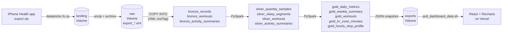

# Health Analytics Platform

An end-to-end analytics product over Apple Health data. An iPhone Health export is loaded into
**Databricks** through Unity Catalog **Volumes** and **`COPY INTO`**, modeled with **PySpark** into
bronze, silver and gold Delta tables, and served through a **React + Recharts** dashboard on **Vercel**.

**Live dashboard:** https://health-analytics-platform-two.vercel.app/

> The published data is **synthetic**. [`generator/generate_export.py`](generator/generate_export.py)
> writes a year of Apple Health data in Apple's exact export format for a fictional runner
> training for a half marathon. No real person's health data is in this repo or on the dashboard.



## What's in the repo

| Path | What it is |
|---|---|
| [`generator/generate_export.py`](generator/generate_export.py) | Standard-library Python that writes a realistic `export.zip`: overlapping iPhone + Watch samples, sleep stages, workouts with nested `WorkoutStatistics`, Activity rings, US Eastern DST offsets |
| [`data/sample/export.zip`](data/sample/export.zip) | The generated sample (seed 42, Oct 2025 – Sep 2026, about 73K elements) |
| [`databricks.yml`](databricks.yml) | Databricks Asset Bundle: deploys the notebooks and a five-task serverless job |
| [`databricks/notebooks/`](databricks/notebooks) | `00_setup` → `01_bronze_ingest` → `02_silver_model` → `03_gold_model` → `04_export_dashboard` |
| [`scripts/run_pipeline.sh`](scripts/run_pipeline.sh) | One command: deploy, land an export, run the job, pull the JSON |
| [`dashboard/`](dashboard) | Vite + React 18 + Recharts static site, deployed to Vercel |

## The pipeline

**00 · Setup.** Creates the schema and three Volumes: `landing` (zips as the phone produces them),
`raw` (extracted XML), `exports` (dashboard JSON).

**01 · Bronze ingest.** Unzips each new export to a uniquely named `export_<timestamp>.xml` and archives
the zip. Then three `COPY INTO` statements load Apple's `<Record>`, `<Workout>` and `<ActivitySummary>`
elements straight from XML into Delta, each with `_source_file` and `_ingested_at`. Every attribute stays a
string (`inferSchema = false`); tables start as schemaless placeholders and `mergeSchema` lets the first load
define them. `COPY INTO` tracks loaded files, so re-running the job never double-loads.

**02 · Silver.** Typed, unit-normalized, de-duplicated tables:

- **Two timestamps per event.** Apple writes `2026-03-14 07:12:44 -0400`. Silver keeps the true instant
  (UTC) *and* the wall-clock local time, because "which day was this?" has to follow the wearer's clock.
- **One unit per metric.** kg → lb, km → mi, kJ → kcal, driven by a mapping table, so a phone set to
  metric doesn't corrupt trends.
- **Re-exports are safe.** Every Health export contains the whole history. Landing a second one
  duplicates everything in bronze. Silver keeps one row per natural key (latest ingest wins).
- **XML shape drift.** Spark infers a repeated child element as an array only if some row has more than
  one, so `MetadataEntry` can arrive as a struct or an array depending on the export. Silver handles both.
- **Bad values never fail the job.** Casts use `try_cast`; unparseable rows are dropped and unmodeled
  HealthKit types are reported.
- **Sleep belongs to a morning.** Each sleep segment is credited to the night that ends on `night_date`
  (start time + 12 h), so a 10:30 PM and a 3:00 AM segment land on the same night.

**03 · Gold.** Analytical tables on a gap-free date spine:

- **Source-priority de-duplication.** The iPhone in a pocket and the Watch on a wrist both record the same
  walk. Within each hour, additive metrics (steps, distance, energy, exercise minutes) come from one device:
  Watch, then iPhone, then anything else. On the sample data, naive summing overstates steps by about 37%.
- **Rolling windows.** 7- and 28-day averages for steps, resting heart rate, HRV and sleep.
- **Heart-rate zones.** Heart-rate samples are range-joined onto the workout they fall inside; each sample
  counts until the next one (capped at 5 minutes), bucketed into five zones by percent of max HR.
- **Data-quality gates.** One row per date, no gaps, no negative steps, plausible sleep and resting HR,
  de-duplicated steps ≤ naive steps, zone minutes reconcile to workout duration. Any failure fails the job
  before the dashboard gets new numbers.

**04 · Export.** Writes the gold tables and a `meta.json` of headline KPIs to the `exports` Volume.

## Running it

Requirements: a Databricks workspace (the free [Databricks Free Edition](https://www.databricks.com/learn/free-edition)
works; everything runs on serverless) and the [Databricks CLI](https://docs.databricks.com/dev-tools/cli/install.html).

```bash
databricks auth login --host https://<your-workspace>.cloud.databricks.com
scripts/run_pipeline.sh                 # deploy, land the sample, run, pull JSON into dashboard/public/data
cd dashboard && npm install && npm run dev
```

Defaults are catalog `workspace`, schema `health`. Override with
`databricks bundle deploy --var catalog=main --var schema=health` (and `CATALOG=` / `SCHEMA=` for the scripts).

To regenerate the sample: `python generator/generate_export.py --days 365 --seed 42`.

### Using a real export

On the iPhone: **Health → profile picture → Export All Health Data**, then
`scripts/run_pipeline.sh path/to/export.zip`. Real exports are gitignored under `data/private/`.
**Don't commit the resulting `dashboard/public/data/` or deploy it publicly**: the JSON is your health data.

## Dashboard

`dashboard/` is a static Vite build. It reads `/data/*.json` at load time, so refreshing the numbers is a
JSON pull and a redeploy, with no warehouse queries or credentials in the browser. To deploy on Vercel,
import the GitHub repo, set **Root Directory** to `dashboard`, and keep the detected Vite settings.

Charts follow a validated, colorblind-safe palette with light and dark themes. Every chart has hover
tooltips, multi-series charts have legends, and the daily data is available as a table.
